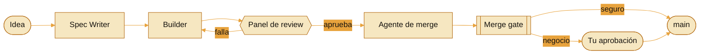

<p align="center">
  
</p>

<p align="center">
  <a href="https://github.com/Tortillaa/prz-factory/actions/workflows/test.yml"></a>
  <a href="LICENSE"></a>
  
  
</p>

<p align="center"><b>Una fábrica de software para agentes de código.</b><br>Escribes una idea; un equipo de agentes la redacta, la construye, la revisa y la mergea.</p>

<p align="center">
  <a href="#cómo-funciona">Cómo funciona</a> ·
  <a href="#inicio-rápido">Inicio rápido</a> ·
  <a href="#uso-diario">Uso diario</a> ·
  <a href="#reglas-para-los-agentes">Reglas</a> ·
  <a href="#desarrollo">Desarrollo</a>
</p>

## En 30 segundos

Los agentes de código ya escriben buen código. Lo que falta para dejarlos trabajar solos es todo lo de alrededor: saber exactamente qué hay que hacer, que alguien revise con criterio, que nada llegue a `main` sin pasar los tests y que una persona decida lo que importa.

prz-factory pone eso en código. Un tablero kanban local reparte cada tarjeta entre agentes con un solo rol cada uno, y un merge gate decide qué llega a `main`: lo pequeño entra solo; lo que toca el negocio te espera con una explicación y un botón de aprobar. Corre dentro de [Orca](https://www.onorca.dev/), que da a cada agente su propio git worktree, y funciona con Claude Code y con Grok.

## Cómo funciona



Una tarjeta recorre el tablero (`spec → ready → building → review → merge → done`), y en cada columna trabaja un agente distinto, en su propio worktree:

1. **Spec Writer.** Lee el código, recorta la idea a lo mínimo que resuelve el problema y la escribe como tarjeta, con criterios de aceptación que se puedan probar y su riesgo. Si falta una decisión de producto, te pregunta en vez de inventarla.
2. **Builder.** Construye la tarjeta en su rama, con los tests primero.
3. **Panel de review.** Cuatro reviewers revisan el mismo commit en paralelo, cada uno desde una lente: qa, seguridad, código y operaciones. Basta un fallo para que la tarjeta vuelva al Builder.
4. **Agente de merge.** Comprueba si el cambio toca el negocio y te lo explica en lenguaje claro.
5. **Merge gate.** Aterriza solo el commit exacto que aprobó el panel, con `verify` en verde y por fast-forward. Si el cambio es de riesgo alto, lleva una etiqueta de negocio, toca una ruta sensible o es grande, lo retiene hasta que lo apruebes.

Ningún agente puede saltarse un paso. Lo impiden el código del tablero, el gate y unos guards que vigilan cada comando: ver [Reglas para los agentes](#reglas-para-los-agentes).

## Resultados

Validado con agentes reales en este mismo repositorio. El detalle está en [docs/VALIDACION.md](docs/VALIDACION.md).

| Caso | Qué pasó |
|---|---|
| Cambio pequeño (#11, título de la pestaña) | De la idea a `main` en **12 minutos, sin intervención**: spec, build, panel ligero y merge automático |
| Cambio sensible (#9 y #10, hooks de git) | Panel completo; el gate lo **retuvo para aprobación** con qué cambia, por qué pregunta y cómo deshacerlo |
| Rama desfasada (#6 y #8) | El gate **rebasó él solo** y mergeó sin volver a revisar, porque el cambio era idéntico al aprobado |
| Arreglo de seguridad incompleto (#8) | El reviewer de seguridad encontró, con pruebas en git, nueve formas de saltarse el guard antes de aprobarlo |
| Evals de las skills | Las 8 pasaron con agentes reales (Sonnet, Grok y Haiku) el 12 de noviembre de 2026 |

## Inicio rápido

Necesitas Node 22 o superior, git, [Orca](https://www.onorca.dev/) y Claude Code. Si algún rol va a correr en Grok, también su CLI (`irm https://x.ai/cli/install.ps1 | iex` en Windows). No hay dependencias que instalar.

**1. Una vez por máquina**, enseña a tus agentes a traer la fábrica. Esto instala la skill global `prz-factory-init`:

```sh
git clone --depth 1 https://github.com/Tortillaa/prz-factory.git prz-factory-tmp
node prz-factory-tmp/bin/factory.mjs install --user
rm -rf prz-factory-tmp      # en PowerShell: Remove-Item -Recurse -Force prz-factory-tmp
```

**2. En tu proyecto**, abre un agente y dile:

> inicializa prz-factory

El agente copia la fábrica dentro del proyecto y te guía por la configuración: comprueba que los tests pasan, te pregunta qué merges quieres aprobar tú y escribe las reglas en el `CLAUDE.md`.

**3. Commitea** `.prz-factory/`, `.claude/` y `factory.config.json`. Cada agente trabaja en un worktree nuevo y los necesita.

**4. Arranca:**

```sh
node .prz-factory/bin/factory.mjs serve     # el tablero, en http://localhost:4747
```

Pide un cambio al agente del IDE en el chat (skill `factory-intake`) y, en una sesión de Claude Code dentro de Orca, pide `/factory-run` ("arranca la fábrica").

## Uso diario

A partir de aquí, `factory` es `node .prz-factory/bin/factory.mjs`. Para teclear solo `factory`, ejecuta `npm link` dentro de `.prz-factory`.

| Para | Haz |
|---|---|
| Pedir un cambio | díselo al agente del IDE en el chat: la skill `factory-intake` redacta la tarjeta, te pregunta lo que el código no decide y la crea en Ready |
| Poner la fábrica a trabajar | `/factory-run` en una sesión de Claude Code dentro de Orca |
| Ver qué pasa | el tablero (`factory serve`), o `factory status` |
| Aprobar un merge que te espera | la franja de solicitudes del tablero → "Aprobar y mergear", o `factory merge <id> --sha <sha> --human` |
| Contestar una pregunta de un agente | un comentario en la tarjeta, y arrástrala de vuelta a su columna |
| Ver cuánto ha costado | `factory report`: workers y minutos por rol, modelo y tarjeta |
| Parar | pide "stop" al coordinador |
| Limpiar worktrees y ramas de tarjetas terminadas | `factory cleanup --apply` |
| Actualizar la fábrica | pide "actualiza prz-factory": reemplaza `.prz-factory/` y las skills, y no toca tu configuración |

`factory --help` lista todos los comandos, y [docs/GUIA.md](docs/GUIA.md) explica el día a día paso a paso.

## Despliegue

Lo que hace `prz-factory-init` por dentro, para instalar sin la skill, con Grok o a mano.

### Instalar

Pídeselo al agente con la ruta completa:

> Instala prz-factory en este repositorio: clona `https://github.com/Tortillaa/prz-factory.git` con `git clone --depth 1` en la carpeta `.prz-factory-src`, ejecuta `node .prz-factory-src/bin/factory.mjs install .`, borra `.prz-factory-src` y después sigue la skill factory-onboard que se acaba de instalar.

O hazlo tú, en la terminal del proyecto:

```sh
git clone --depth 1 https://github.com/Tortillaa/prz-factory.git .prz-factory-src
node .prz-factory-src/bin/factory.mjs install .
rm -rf .prz-factory-src      # en PowerShell: Remove-Item -Recurse -Force .prz-factory-src
```

El clon va dentro del proyecto para que el guard `delete-outside` deje borrarlo. Para actualizar, repite las mismas tres líneas. La instalación deja esto:

| Carpeta o archivo | Qué es |
|---|---|
| `.prz-factory/` | El CLI, el tablero web, los guards, las skills y el plugin de Orca |
| `.claude/skills/` | Las skills que leen los agentes (Claude Code y Grok) |
| `.claude/hooks/` y `.claude/settings.json` | Los guards de seguridad |
| `factory.config.json` | La configuración del proyecto |

### Configurar

Es lo que hace la skill `factory-onboard`, paso a paso:

1. En `factory.config.json`, los comandos de `verify`, las rutas sensibles (`merge.humanPaths`) y el modelo de cada rol (`agents`).
2. Las reglas en el `CLAUDE.md` del proyecto: `factory agents-md`.
3. La comprobación: `factory doctor`. Todo debe salir en verde.
4. Si algún rol corre en Grok, `grok --trust inspect` una vez en la carpeta del proyecto.

### Quitar

Borra `.prz-factory/`, las carpetas de `.claude/skills/` que tienen un archivo `.factory-managed`, `.claude/hooks/factory-guard.mjs`, las entradas de `factory-guard` en `.claude/settings.json`, el bloque `prz-factory` de `CLAUDE.md` y `factory.config.json`.

## Reglas para los agentes

Cada regla la hace cumplir el código, no la buena voluntad del agente. `factory agents-md` escribe el resumen en el `CLAUDE.md` (o `AGENTS.md`) de cada proyecto, y cada skill repite las de su rol en su sección "Never".

| Regla | Quién la hace cumplir |
|---|---|
| El tablero se lee y se cambia solo con el CLI `factory`, nunca editando `board.json` | `src/store.mjs`: lock y escritura atómica |
| Una tarjeta entra en Ready solo si pasa `factory lint`, y sale solo con sus dependencias en Done | `src/store.mjs`, `src/ticket.mjs` |
| Un agente por tarjeta (y uno por lente en la revisión); cada uno en su worktree, nunca en el checkout principal | `claim` en `src/store.mjs`, `startLane` en `src/lanes.mjs` |
| Cada rol solo puede pasar la tarjeta a sus columnas; ninguno la mueve a Done | `LANES` en `src/lanes.mjs` |
| Solo el merge gate aterriza código: el commit exacto que aprobó todo el panel, con `verify` en verde | `src/merge.mjs` |
| Lo que toca el negocio lo aprueba una persona: riesgo High, etiquetas `auth`, `payments`, `pricing`, `schema`, `ops`, rutas sensibles o un diff grande | `src/merge.mjs`, `merge` en `factory.config.json` |
| Un agente puede subir una tarjeta a revisión humana, nunca bajarla; nunca usa `--human` ni `--force` | skills; el gate solo acepta `--human` con la etiqueta `merge-approval`, que solo pone él |
| Nada de `git merge`, commit o push sobre la rama base desde un worker | guard `protected-push` |
| Ningún push que no sea fast-forward (ni borrado) a una rama protegida, se escriba como se escriba | hook de git `pre-push` (`hooks/factory-pre-push.mjs`, lo instala `factory install`); el guard `protected-push` veta `--no-verify` y `core.hooksPath` |
| `main` no admite force-push ni borrado, ni siquiera saltándose lo anterior | protección de rama en GitHub (en el servidor) |
| No leer `.env` ni archivos de claves; no escribir claves literales | guards `secrets` y `key-literals` |
| Borrados recursivos solo dentro del proyecto | guard `delete-outside` |
| No inventar una decisión de producto: la tarjeta va a `blocked` con la pregunta | skills `factory-spec`, `factory-build`, `factory-review` |
| El mínimo código que resuelve la tarjeta; el que no debería existir se devuelve | skills `ponytail` y `ponytail-review` |
| Una pantalla no sale con aspecto de "hecha por IA" (degradados morados, brillos, emojis, textos que gritan): sigue la dirección de la tarjeta | skill `unslop`, en el Spec Writer, el Builder y la lente `code` |
| Un cambio de pantalla se entrega con una línea `Design:` y una captura de lo que se vio (o `--no-screenshot` y el motivo), y la lente `code` lo aprueba diciendo cómo lo miró | `handoff` y `verdict` en `src/lanes.mjs`, `ui.paths` en `factory.config.json` |
| Commits y comentarios en un formato único, con evidencias | `skills/factory-board/references/writing-standard.md` |
| Un agente que ya no se usa se elimina solo: su terminal al terminar su trabajo y su workspace cuando la tarjeta llega a Done, sin depender del coordinador | `factory dispatch` (`src/dispatch.mjs`), `findLeftovers` en `src/cleanup.mjs` |
| A la décima ronda fallida, o al segundo worker caído, la tarjeta para y espera a una persona | `sendBack` en `src/store.mjs`, `reclaim` en `src/run.mjs` |

Los guards (`hooks/factory-guard.mjs`) funcionan igual con Claude Code y con Grok.

**Modelo de amenaza.** Las barreras locales (guards, hooks y el merge gate) protegen contra **errores**: un agente que hace algo mal por despiste o por una mala instrucción. No intentan parar a un agente que se las quiere saltar a propósito, porque todo lo que corre en la máquina se puede deshacer desde la máquina. Esa garantía la da el servidor: en este repo, `main` está protegida en GitHub contra force-push y borrado. En otro proyecto, activa lo mismo en su repositorio (Settings → Branches; en repos privados requiere GitHub Pro).

## Roles de agentes

Cada rol es un worker de Orca en su propio worktree, y carga su skill solo, por la tarea que recibe. El modelo de cada uno se elige en `agents` de `factory.config.json`; un proyecto recién instalado corre todos en Claude.

| Rol | Trabaja en | Termina con | Skill | Modelo en este repo |
|---|---|---|---|---|
| **Coordinador**: lanza a los demás con `factory dispatch`, reconcilia el tablero y te trae cada solicitud. Nunca redacta, construye, revisa ni mergea | — | — | `factory-run` | el de tu sesión |
| **Recepción**: el agente del IDE; convierte lo que pides en el chat en tarjetas. Nunca construye ni revisa | chat | `factory add` a `ready` (o `backlog`) | `factory-intake` + `factory-spec` + `ponytail` | el de tu sesión |
| **Spec Writer**: para las ideas que dejas en `spec` sin redactar | `spec` | `handoff` a `ready` o `blocked` | `factory-spec` + `ponytail` | Claude Sonnet 5.5, con advisor Fable 5.2 |
| **Builder** | `building` | `handoff` a `review` o `blocked` | `factory-build` + `ponytail` | Claude Sonnet 5.5, con advisor Fable 5.2 |
| **Reviewers**, uno por lente | `review` | `verdict`: pass, fail o escalar | `factory-review` + `ponytail-review` | Claude Sonnet 5.5, esfuerzo alto (Grok 4.7 cuando tiene saldo) |
| **Agente de merge** | `merge` | `merge`, o `handoff` a `blocked` | `factory-merge` | Claude Haiku 5.5 |
| **QA**: solo para tarjetas con la etiqueta `qa`; prueba lo que ya está en la rama base | `qa` | `merge` (cierra la tarjeta) | `factory-qa` | Claude |

Qué mira cada lente del panel (`skills/factory-review/references/lenses.md`). Una tarjeta de riesgo Low sin etiqueta de negocio pasa solo por `qa` y `code`:

| Lente | Su pregunta |
|---|---|
| `qa` | ¿Hace lo que dice la tarjeta, y hay un test que lo notaría si dejara de hacerlo? |
| `security` | ¿Se puede abusar de este cambio? |
| `code` | ¿Es el cambio correcto, y hace falta cada línea? |
| `ops` | ¿Qué le hace esto al negocio y al producto en marcha? |

El advisor es una herramienta de Claude Code: el modelo lo consulta en las partes difíciles y el advisor aconseja sin tocar archivos. Se activa con `"advisorModel": "fable"` en `.claude/settings.json`; sin él, el Spec Writer y el Builder recurren a un subagente Opus.

## Skills

`skills/` es la fuente. `factory install` las copia a `.claude/skills/` de cada proyecto, y los agentes las eligen solos por su descripción: ninguna hay que invocarla a mano.

Cada rol carga la suya (ver [Roles de agentes](#roles-de-agentes)): `factory-run`, `factory-spec`, `factory-build`, `factory-review`, `factory-merge` y `factory-qa`. Además:

| Skill | Quién la usa | Para qué |
|---|---|---|
| `factory-board` | Todos | Leer y cambiar el tablero con el CLI; incluye el estándar de escritura |
| `factory-intake` | El agente del IDE (Recepción) | Convertir lo que pides en el chat en tarjetas, con preguntas en el chat y creadas en Ready |
| `ponytail` | Spec Writer y Builder | El mínimo cambio que resuelve el problema entero |
| `ponytail-review` | Reviewers | Revisar como quien recibirá el aviso cuando falle |
| `unslop` | Spec Writer, Builder y la lente `code`, cuando la tarjeta cambia una pantalla | Auditar la interfaz, fijar una dirección propia del producto y corregirla en nueve pasadas (espaciado, color, iconos, textos, tipografía, maquetación, detalles, visuales y movimiento) |
| `factory-lint` | Tú, con un agente | Escribir o repasar tarjetas a mano |
| `factory-collect` | Tú, con un agente | Buscar problemas en el código y convertirlos en tarjetas |
| `factory-onboard` | Tú, con un agente | Configurar la fábrica en un proyecto, o repararla si `doctor` falla |
| `prz-factory-init` | Tú, con un agente, en cualquier repo | Traer la fábrica a un proyecto o actualizarla. Vive en `user-skills/` y se instala una vez por máquina con `factory install --user` |

## Plugin para Orca

La forma principal de usar el tablero desde Orca: un panel en la barra lateral derecha con el tablero de cada repo abierto, en vivo. Arriba, **Te esperan** (aprobar un merge retenido, contestar a una tarjeta que pide algo) y **En marcha** (cada tarjeta con el riel de estaciones spec · build · review · merge, las lentes de review y el rol de quien la tiene), **Cola** en el orden en que saldrá y **Hecho**, sin las nueve columnas. `factory serve` es la alternativa, en el navegador. El panel es un cliente más del tablero, como la web: su worker atiende `card.get`, `card.add`, `card.edit`, `card.move`, `card.comment` y `card.approve` ejecutando el CLI de cada repo, así que el lint, los bloqueos y el merge gate siguen siendo los mismos y el plugin nunca escribe `board.json`.

Se instala una vez por máquina, desde cualquier proyecto que tenga la fábrica. Como el plugin ejecuta su propio proceso de Node, Orca pide tu aprobación: el primer comando enseña lo que podrá hacer y una huella `ap1-…`, y el segundo lo instala con esa huella.

```sh
orca plugin install .prz-factory/orca-plugin
orca plugin install .prz-factory/orca-plugin --approve ap1-<la huella que te ha dado>
orca plugin open local.prz-factory-board --panel board
```

Si actualizas la fábrica y el plugin ha cambiado, la huella cambia y Orca pide aprobarlo de nuevo. Más detalle en [orca-plugin/README.md](orca-plugin/README.md).

## Desarrollo

```sh
npm test                                   # suite completa (Node test runner)
node --test --test-name-pattern "<nombre>" "test/*.test.mjs"
node bin/factory.mjs install .             # tras tocar skills/ u hooks/: refresca las copias de .claude/
node bin/factory.mjs eval [caso]           # evals de skills con un agente real (usa tu cuenta)
cd orca-plugin && orca plugin test .
```

Los cambios llegan a `main` por pull request; CI ejecuta `npm test` en Linux, macOS y Windows con Node 22 y 24. El guard `protected-push` impide el push directo a `main` desde una sesión de agente. Lo que se mergea en `main` es la versión que recibe cada proyecto al instalar o actualizar.

| Documento | Contenido |
|---|---|
| [CLAUDE.md](CLAUDE.md) | Arquitectura: tablero, lanes, merge gate, coordinador y guards |
| [ROADMAP.md](ROADMAP.md) | El plan por fases, con su estado |
| [docs/GUIA.md](docs/GUIA.md) | Guía de uso para quien trabaja con la fábrica |
| [docs/VALIDACION.md](docs/VALIDACION.md) | Pruebas con agentes reales: tiempos, coste y fallos |

## Licencia y créditos

[MIT](LICENSE). Inspirada en [super-board](https://github.com/EricTechPro/super-board) (MIT), con tablero propio en `localhost` en lugar de GitHub Projects y merges locales por fast-forward. Incluye sin modificar [ponytail](https://github.com/DietrichGebert/ponytail) (MIT) y [unslop](https://github.com/heydamir/unslop), de Damir Sokolovsky ([@heydamir](https://x.com/heydamir)) (CC BY 4.0), cada una con su licencia.

<br>
<p align="center">
  <sub>Hecho a fuego lento por <a href="https://github.com/Tortillaa">Tortillaa</a></sub>
</p>
