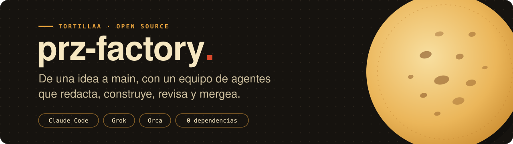

<p align="center">
  
</p>

<p align="center">
  <a href="https://github.com/Tortillaa/prz-factory/actions/workflows/test.yml"></a>
  <a href="LICENSE"></a>
  
  
</p>

<p align="center"><b>Una fábrica de software para agentes de código.</b><br>Escribes una idea; un equipo de agentes la redacta, la construye, la revisa desde cuatro puntos de vista y la mergea.</p>

<p align="center">
  <a href="#inicio-rápido">Inicio rápido</a> ·
  <a href="#cómo-funciona">Cómo funciona</a> ·
  <a href="#reglas-para-los-agentes">Reglas</a> ·
  <a href="#roles-de-agentes">Roles</a> ·
  <a href="#desarrollo">Documentación</a>
</p>

## En 30 segundos

prz-factory convierte un tablero kanban en una cadena de montaje de agentes. Corre dentro de [Orca](https://www.onorca.dev/), que da a cada agente su propio git worktree, y funciona con Claude Code y con Grok. Los cambios pequeños llegan a `main` solos; los que tocan el negocio te esperan con una explicación en lenguaje claro y un botón de aprobar.

En este mismo repo, un cambio pequeño fue **de la idea a `main` en 12 minutos, sin que nadie lo tocara**.

> [!TIP]
> ¿Lo quieres probar ya? Instala la skill una vez y dile a tu agente **"inicializa prz-factory"** en cualquier repo. Tres líneas en [Inicio rápido](#inicio-rápido).

## Por qué

Los agentes de código ya escriben buen código. Lo que falta para dejarlos trabajar solos es todo lo de alrededor: saber qué hay que hacer exactamente, que alguien revise con criterio, que nada llegue a `main` sin pasar los tests y que una persona decida lo que importa. prz-factory pone eso en código, no en buenas intenciones:

- **Un tablero como fuente de verdad.** Kanban local en `localhost`, compartido por todos los worktrees. El estado vive en el tablero, no en la memoria de una sesión.
- **Un rol por paso, cada uno con su modelo.** Redactar, construir, revisar y mergear son agentes distintos, con instrucciones distintas y sin poder pisarse.
- **Un panel de revisión en paralelo.** Cuatro lentes revisan el mismo commit: qa, seguridad, código y operaciones. Todas deben aprobarlo.
- **Un merge gate que no se negocia.** Solo aterriza el commit exacto que aprobó el panel, con `verify` en verde y por fast-forward: lo que llega a `main` es lo que se probó.
- **Las personas, donde importan.** Riesgo alto, etiquetas de negocio, rutas sensibles o un diff grande: el gate retiene el merge y te lo explica.
- **Guards contra errores.** Hooks que impiden leer secretos, empujar a `main`, forzar una rama protegida o borrar fuera del proyecto.

## Cómo funciona

```mermaid
%%{init: {"theme": "base", "themeVariables": {"primaryColor": "#F6E7C1", "primaryTextColor": "#16130F", "primaryBorderColor": "#B36A12", "lineColor": "#E8A33D", "secondaryColor": "#E8A33D", "tertiaryColor": "#FBF3E1", "fontFamily": "ui-sans-serif, Segoe UI, Helvetica, Arial"}}}%%
flowchart LR
  idea([Idea]) --> spec["Spec Writer: redacta la tarjeta"]
  spec --> build["Builder: tests primero"]
  build --> panel{{"Panel de review: qa · security · code · ops"}}
  panel -- falla --> build
  panel -- aprueba --> merge[Agente de merge]
  merge --> gate[["Merge gate: verify y fast-forward"]]
  gate -- cambio seguro --> main([main])
  gate -- toca el negocio --> you([Tu aprobación])
  you --> main
```



Cada caja es un agente distinto, lanzado por el coordinador en su propio worktree. Las tarjetas avanzan por el tablero (`spec → ready → building → review → merge → done`) y nadie puede saltarse una columna: el código del tablero y del gate lo impide.

## Resultados

Validado con agentes reales en este mismo repositorio (detalle en [docs/VALIDACION.md](docs/VALIDACION.md)):

| Caso | Qué pasó |
|---|---|
| Cambio pequeño (#11, título de la pestaña) | De la idea a `main` en **12 minutos, sin intervención**: spec, build, panel ligero y merge automático |
| Cambio sensible (#9 y #10, hooks de git) | Panel completo; el gate lo **retuvo para aprobación** con qué cambia, por qué pregunta y cómo deshacerlo |
| Rama desfasada (#6 y #8) | El gate **rebasó él solo** y mergeó sin volver a revisar, porque el cambio era idéntico al aprobado |
| Arreglo de seguridad incompleto (#8) | El reviewer de seguridad encontró, con pruebas en git, nueve formas de saltarse el guard antes de aprobarlo |
| Evals de las skills | Las 8 pasaron con agentes reales (Sonnet, Grok y Haiku) el 12 de noviembre de 2026 |

## Inicio rápido

**1. Una vez por máquina**, instala la skill que enseña a cualquier agente a traer la fábrica:

```sh
git clone --depth 1 https://github.com/Tortillaa/prz-factory.git prz-factory-tmp
node prz-factory-tmp/bin/factory.mjs install --user
rm -rf prz-factory-tmp      # en PowerShell: Remove-Item -Recurse -Force prz-factory-tmp
```

**2. En cualquier proyecto**, abre tu agente y dile:

> inicializa prz-factory

El agente descarga la fábrica, la copia dentro del proyecto y te guía por la configuración: prueba los tests, te pregunta la política de merge y escribe las reglas para los agentes.

**3. A trabajar:**

```sh
node .prz-factory/bin/factory.mjs serve     # el tablero, en http://localhost:4747
```

Escribe una idea con "+ Nueva idea" y, en una sesión de Claude Code dentro de Orca, pide `/factory-run` ("arranca la fábrica").

## Despliegue

### Requisitos

- Node 22 o superior y git. Sin dependencias ni paso de build.
- [Orca](https://www.onorca.dev/), para lanzar los agentes. El tablero y el CLI funcionan sin él.
- Claude Code y, si algún rol corre en Grok, el CLI de Grok (`irm https://x.ai/cli/install.ps1 | iex` en Windows).

El repositorio es público: no hacen falta credenciales ni instalar nada de forma global.

### Instalar en un proyecto

Con la skill `prz-factory-init` instalada (ver [Inicio rápido](#inicio-rápido)), basta con pedírselo al agente. Sin ella, dale la ruta completa:

> Instala prz-factory en este repositorio: clona `https://github.com/Tortillaa/prz-factory.git` con `git clone --depth 1` en la carpeta `.prz-factory-src`, ejecuta `node .prz-factory-src/bin/factory.mjs install .`, borra `.prz-factory-src` y después sigue la skill factory-onboard que se acaba de instalar.

O hazlo tú, en la terminal del proyecto:

```sh
git clone --depth 1 https://github.com/Tortillaa/prz-factory.git .prz-factory-src
node .prz-factory-src/bin/factory.mjs install .
rm -rf .prz-factory-src      # en PowerShell: Remove-Item -Recurse -Force .prz-factory-src
```

El clon va dentro del proyecto para que el guard `delete-outside` deje borrarlo. La instalación deja la fábrica entera dentro del proyecto:

| Carpeta o archivo | Qué es |
|---|---|
| `.prz-factory/` | El CLI, el tablero web, los guards, las skills y el plugin de Orca |
| `.claude/skills/` | Las skills que leen los agentes (Claude Code y Grok) |
| `.claude/hooks/` y `.claude/settings.json` | Los guards de seguridad |
| `factory.config.json` | La configuración del proyecto |

Después:

1. **Configura** `factory.config.json`: los comandos de `verify`, las rutas sensibles (`merge.humanPaths`) y el modelo de cada rol (`agents`). La skill `factory-onboard` te lo pregunta paso a paso.
2. **Escribe las reglas** en el `CLAUDE.md` del proyecto: `node .prz-factory/bin/factory.mjs agents-md`.
3. **Comprueba**: `node .prz-factory/bin/factory.mjs doctor`. Todo debe salir en verde.
4. **Commitea** `.prz-factory/`, `.claude/` y `factory.config.json`. Cada agente trabaja en un worktree nuevo y los necesita.
5. Si algún rol corre en Grok, ejecuta una vez `grok --trust inspect` en la carpeta del proyecto.

En el resto de este README, `factory` es `node .prz-factory/bin/factory.mjs`. Para teclear solo `factory`, ejecuta `npm link` dentro de `.prz-factory`.

### Arrancar

```sh
factory serve          # el tablero, en http://localhost:4747
```

Y en una sesión de Claude Code dentro de Orca, en el proyecto: `/factory-run` (o "arranca la fábrica").

### Actualizar o quitar

- **Actualizar** a la última versión: pide "actualiza prz-factory", o repite las tres líneas de la instalación. Reemplaza `.prz-factory/` y las skills gestionadas; no toca tu configuración ni una skill tuya con el mismo nombre.
- **Quitar**: borra `.prz-factory/`, las carpetas de `.claude/skills/` que tienen un archivo `.factory-managed`, `.claude/hooks/factory-guard.mjs`, las entradas de `factory-guard` en `.claude/settings.json`, el bloque `prz-factory` de `CLAUDE.md` y `factory.config.json`.

### Publicar una versión de la fábrica

Los cambios de este repo llegan a `main` por rama y pull request: el guard `protected-push` bloquea el push directo a `main` desde una sesión de agente. Una vez en `main`, cada proyecto la recibe al repetir la instalación (`git clone` de `main`).

## Plugin para Orca

Un panel en la barra lateral derecha de Orca con el tablero de cada repo abierto: las tarjetas por columna, quién tiene cada una y las que esperan a una persona. Se actualiza en vivo. Es de solo lectura: mover tarjetas sigue siendo cosa del CLI, de la web y de los agentes.

Se instala una vez por máquina, desde cualquier proyecto que tenga la fábrica:

```sh
orca plugin install .prz-factory/orca-plugin
```

El plugin ejecuta su propio proceso de Node, así que Orca no lo activa sin tu aprobación. Ese comando no instala nada todavía: enseña lo que el plugin podrá hacer (ejecutar su código con tu usuario y leer la lista de workspaces) y una huella `ap1-…`. Si estás de acuerdo, repítelo con la huella:

```sh
orca plugin install .prz-factory/orca-plugin --approve ap1-<la huella que te ha dado>
orca plugin open local.prz-factory-board --panel board
```

Desde un clon de este repo, la carpeta es `./orca-plugin`. Si actualizas la fábrica y el plugin ha cambiado, la huella cambia y Orca pide aprobarlo de nuevo. Más detalle en [orca-plugin/README.md](orca-plugin/README.md).

## Reglas para los agentes

Cada regla la hace cumplir el código, no la buena voluntad del agente. `factory agents-md` escribe el resumen en el `CLAUDE.md` (o `AGENTS.md`) de cada proyecto, y cada skill repite las de su rol en su sección "Never".

| Regla | Quién la hace cumplir |
|---|---|
| El tablero se lee y se cambia solo con el CLI `factory`, nunca editando `board.json` | `src/store.mjs`: lock y escritura atómica |
| Una tarjeta entra en Ready solo si pasa `factory lint`, y sale solo con sus dependencias en Done | `src/store.mjs`, `src/ticket.mjs` |
| Un agente por tarjeta (y uno por lente en la revisión); cada uno en su worktree, nunca en el checkout principal | `claim` en `src/store.mjs`, `startLane` en `src/lanes.mjs` |
| Cada rol solo puede pasar la tarjeta a sus columnas; ninguno la mueve a Done | `LANES` en `src/lanes.mjs` |
| Solo el merge gate aterriza código: el commit exacto que aprobó todo el panel, con `verify` en verde | `src/merge.mjs` |
| Lo que toca el negocio lo aprueba una persona: riesgo High, etiquetas `auth`, `payments`, `pricing`, `schema`, `ops`, rutas sensibles o un diff grande | `src/merge.mjs`, `merge` en `factory.config.json` |
| Un agente puede subir una tarjeta a revisión humana, nunca bajarla; nunca usa `--human` ni `--force` | skills; el gate solo acepta `--human` con la etiqueta `merge-approval`, que solo pone él |
| Nada de `git merge`, commit o push sobre la rama base desde un worker | guard `protected-push` |
| `main` no admite force-push ni borrado, se escriba como se escriba | protección de rama en GitHub (en el servidor) |
| Ningún push que no sea fast-forward (ni borrado) a una rama protegida, escrito como se escriba | hook de git `pre-push` (`hooks/factory-pre-push.mjs`, lo instala `factory install`); el guard `protected-push` veta `--no-verify` y `core.hooksPath` |
| No leer `.env` ni archivos de claves; no escribir claves literales | guards `secrets` y `key-literals` |
| Borrados recursivos solo dentro del proyecto | guard `delete-outside` |
| No inventar una decisión de producto: la tarjeta va a `blocked` con la pregunta | skills `factory-spec`, `factory-build`, `factory-review` |
| El mínimo código que resuelve la tarjeta; el que no debería existir se devuelve | skills `ponytail` y `ponytail-review` |
| Commits y comentarios en un formato único, con evidencias | `skills/factory-board/references/writing-standard.md` |
| A la décima ronda fallida, o al segundo worker caído, la tarjeta para y espera a una persona | `sendBack` en `src/store.mjs`, `reclaim` en `src/run.mjs` |

Los guards (`hooks/factory-guard.mjs`) funcionan igual con Claude Code y con Grok.

**Modelo de amenaza.** Las barreras locales (guards, hooks y el merge gate) protegen contra **errores**: un agente que hace algo mal por despiste o por una mala instrucción. No intentan parar a un agente que se las quiere saltar a propósito, porque todo lo que corre en la máquina se puede deshacer desde la máquina. Esa garantía la da el servidor: en este repo, `main` está protegida en GitHub contra force-push y borrado. En otro proyecto, activa lo mismo en su repositorio (Settings → Branches; en repos privados requiere GitHub Pro).

## Roles de agentes

Cada rol es un worker de Orca en su propio worktree. Carga su skill solo, por la tarea que recibe.

| Rol | Trabaja en | Qué hace | Termina con | Skill | Modelo en este repo |
|---|---|---|---|---|---|
| **Coordinador** | — | Lanza a los demás con `factory dispatch`, para los que trabajan en una ronda cerrada, libera los terminales, reconcilia el tablero y te avisa de cada solicitud. Nunca redacta, construye, revisa ni mergea | — | `factory-run` | el de tu sesión |
| **Spec Writer** | `spec` | Lee el código, recorta la idea, la redacta como tarjeta y clasifica su impacto en el negocio | `handoff` a `ready` o `blocked` | `factory-spec` + `ponytail` | Claude Sonnet 5.5; advisor Fable 5.2 si la tarjeta es difícil |
| **Builder** | `building` | Construye la tarjeta en su rama, con los tests primero | `handoff` a `review` o `blocked` | `factory-build` + `ponytail` | Claude Sonnet 5.5; advisor Fable 5.2 para lo difícil |
| **Reviewers**, uno por lente | `review` | Revisan el mismo commit en paralelo: `qa`, `security`, `code` y `ops`. Una tarjeta de riesgo Low sin etiqueta de negocio solo pasa por `qa` y `code` | `verdict`: pass, fail o escalar | `factory-review` + `ponytail-review` | Grok 4.7, esfuerzo alto |
| **Agente de merge** | `merge` | Comprueba si el cambio toca el negocio, te lo explica y lanza el merge gate | `merge`, o `handoff` a `blocked` | `factory-merge` | Claude Haiku 5.5 |
| **QA** | `qa` | Solo para tarjetas con la etiqueta `qa`: prueba lo que ya está en la rama base | `merge` (cierra la tarjeta) | `factory-qa` | Claude |

Qué mira cada lente del panel (`skills/factory-review/references/lenses.md`):

| Lente | Su pregunta |
|---|---|
| `qa` | ¿Hace lo que dice la tarjeta, y hay un test que lo notaría si dejara de hacerlo? |
| `security` | ¿Se puede abusar de este cambio? |
| `code` | ¿Es el cambio correcto, y hace falta cada línea? |
| `ops` | ¿Qué le hace esto al negocio y al producto en marcha? |

El modelo de cada rol se elige en `factory.config.json`. Un proyecto recién instalado corre todos los roles en Claude; esta es la configuración de este repo:

```json
"agents": {
  "spec":   { "agent": "claude", "model": "claude-sonnet-5-5" },
  "build":  { "agent": "claude", "model": "claude-sonnet-5-5" },
  "review": { "agent": "grok",   "model": "grok-4.7", "effort": "high" },
  "merge":  { "agent": "claude", "model": "claude-haiku-5-5" }
}
```

El advisor es una herramienta de Claude Code: el modelo lo consulta cuando lo necesita y el advisor aconseja sin tocar archivos. Se activa con `"advisorModel": "fable"` en `.claude/settings.json`; sin él, el Spec Writer y el Builder recurren a un subagente Opus.

## Skills

`skills/` es la fuente. `factory install` las copia a `.claude/skills/` de cada proyecto, y los agentes las eligen solos por su descripción: ninguna hay que invocarla a mano.

| Skill | Quién la usa | Para qué |
|---|---|---|
| `factory-run` | Coordinador | Vaciar el tablero lanzando un agente por tarjeta y paso |
| `factory-spec` | Spec Writer | Convertir una idea en una tarjeta que se pueda construir |
| `factory-build` | Builder | Construir una tarjeta con tests y entregarla al panel |
| `factory-review` | Reviewers | Revisar un cambio por una lente y dar un veredicto |
| `factory-merge` | Agente de merge | Decidir quién aterriza el cambio y lanzar el merge gate |
| `factory-qa` | QA | Probar lo que ya está en la rama base |
| `factory-board` | Todos | Leer y cambiar el tablero con el CLI; incluye el estándar de escritura |
| `ponytail` | Spec Writer y Builder | El mínimo cambio que resuelve el problema entero |
| `ponytail-review` | Reviewers | Revisar como quien recibirá el aviso cuando falle |
| `factory-lint` | Tú, con un agente | Escribir o repasar tarjetas a mano |
| `factory-collect` | Tú, con un agente | Buscar problemas en el código y convertirlos en tarjetas |
| `factory-onboard` | Tú, con un agente | Instalar y configurar la fábrica en un proyecto |
| `prz-factory-init` | Tú, con un agente, en cualquier repo | Traer la fábrica a un proyecto o actualizarla. Vive en `user-skills/` y se instala una vez por máquina con `factory install --user` |

`ponytail` y `ponytail-review` son de [DietrichGebert/ponytail](https://github.com/DietrichGebert/ponytail) (MIT) y van incluidas sin modificar, con su licencia.

## Uso diario

| Para | Haz |
|---|---|
| Ver el tablero | `factory serve` → http://localhost:4747, o el panel de Orca |
| Pedir un cambio | botón "+ Nueva idea", o `factory add "<idea>" --column spec` |
| Poner la fábrica a trabajar | `/factory-run` en una sesión de Claude Code dentro de Orca |
| Ver qué pasa | `factory status` |
| Ver cuánto ha costado | `factory report`: workers y minutos por rol, modelo y tarjeta |
| Aprobar un merge que te espera | la franja de solicitudes del tablero → "Aprobar y mergear", o `factory merge <id> --sha <sha> --human` |
| Contestar una pregunta de un agente | un comentario en la tarjeta, y arrástrala de vuelta a su columna |
| Parar | pide "stop" al coordinador |
| Limpiar worktrees y ramas de tarjetas terminadas | `factory cleanup --apply` |

`factory --help` lista todos los comandos. La guía paso a paso para quien la usa está en [docs/GUIA.md](docs/GUIA.md).

## Desarrollo

```sh
npm test                                   # suite completa (Node test runner)
node --test --test-name-pattern "<nombre>" "test/*.test.mjs"
node bin/factory.mjs eval [caso]           # evals de skills con un agente real (usa tu cuenta)
node bin/factory.mjs install .             # tras tocar skills/ u hooks/: refresca las copias de .claude/
cd orca-plugin && orca plugin test .
```

| Documento | Contenido |
|---|---|
| [CLAUDE.md](CLAUDE.md) | Arquitectura: tablero, lanes, merge gate, coordinador y guards |
| [ROADMAP.md](ROADMAP.md) | El plan por fases, con su estado |
| [docs/GUIA.md](docs/GUIA.md) | Guía de uso para quien trabaja con la fábrica |
| [docs/VALIDACION.md](docs/VALIDACION.md) | Pruebas con agentes reales: tiempos, coste y fallos |

Los cambios se proponen por pull request contra `main`. CI ejecuta `npm test` en Linux, macOS y Windows con Node 22 y 24.

## Licencia y créditos

[MIT](LICENSE). Inspirada en [super-board](https://github.com/EricTechPro/super-board) (MIT), con tablero propio en `localhost` en lugar de GitHub Projects y merges locales por fast-forward. Incluye [ponytail](https://github.com/DietrichGebert/ponytail) (MIT) sin modificar.

<br>
<p align="center">
  <sub>Hecho a fuego lento por <a href="https://github.com/Tortillaa">Tortillaa</a> · <a href="LICENSE">MIT</a></sub>
</p>
